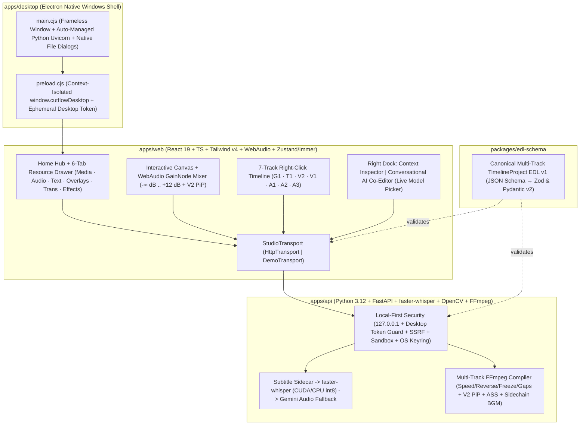

# CutFlow Studio — Native Desktop Video NLE, AI Co-Editor & Automated Clipping Pipeline

**CutFlow Studio** combines a **CapCut Desktop / Premiere Pro-style Multi-Track Non-Linear Editor (`CutFlow Studio.exe`)** with an autonomous highlight discovery pipeline that turns long Twitch/YouTube/Kick VODs, `.mkv` movies & series, and local recordings into finished edits (`9:16`, `4:5`, `1:1`, `16:9`) — while keeping every clip, B-Roll layer, caption word, graphic overlay, and audio stem **100% non-destructive and editable**.

> **Triple-Target Architecture:**
> 1. **Native Windows Desktop App (`apps/desktop` → `CutFlow Studio.exe`):** Frameless dark Studio window that auto-manages the local Python/FFmpeg/Whisper engine, opens local videos with zero-copy speed, and stores API keys in Windows Credential Manager.
> 2. **Local Browser Studio (`cutflow serve`):** Run on `http://127.0.0.1:8010` from any local browser.
> 3. **\$0 Hosted Portfolio Demo Mode (`npm run build:demo`):** Static zero-backend browser demo ready for Vercel, Cloudflare Pages, or Netlify.


---

## Supported Sources & Ingest Matrix

| Source Type | Examples | Supported | Pipeline Behavior |
| :--- | :--- | :---: | :--- |
| **Local Video & Cinema `.mkv` Files** | `.mp4`, `.mkv`, `.mov`, `.webm`, `.avi` + optional `.srt`/`.ass` | **Yes (Zero-Copy Desktop)** | Instant zero-copy local path open in `CutFlow Studio.exe`, NTFS hardlink watch folders, `<0.5s` embedded/sidecar subtitle extraction (`$0` ASR cost), 5.1 Front-Center (`FC`) isolation, and `cropdetect` letterbox stripping. |
| **Twitch Long VODs & Clips** | `https://www.twitch.tv/videos/...` | **Yes** | Instant VOD Inspector (title, duration, stream chapters) → **Full VOD** (`8×` parallel HLS fragments) or **Time Window** (`--download-sections`) + optional browser cookies. |
| **YouTube, Kick, TikTok, X (~1,800 `yt-dlp` sites)** | `youtube.com/watch?v=...`, `kick.com/...` | **Yes** | SSRF-guarded `yt-dlp` ingest + live SSE `MB/s` telemetry + YouTube Most-Replayed heatmap & chapter fusion. |
| **DRM / Anti-Bot Streaming Sites** | Netflix, Disney+, obfuscated web players | **No** | CutFlow does not bypass DRM or anti-bot challenges; drop a local `.mkv` or `.mp4` file instead. |

---

## Key Capabilities

### 1. CapCut Desktop / Premiere Pro 4-Zone NLE (`CutFlow Studio.exe`)
- **CapCut-Style Home Hub:** Create **`+ New Blank Project`** (`9:16`, `16:9`, `1:1`, `4:5`), open local videos directly via native File Explorer dialogs, launch **`AI Auto-Clip VOD / Movie`**, and manage **Recent Projects** via right-click context menus (*Open, Rename, Duplicate, Auto-Captions, Export, Delete*).
- **Top-Left 6-Tab Resource Drawer:** `Media` (zero-copy local bin + `+ Track V1` / `+ PiP V2`), `Audio` (previewable SFX + BGM upload), `Text` (1-click **Generate Auto-Captions**), `Overlays`, `Transitions`, and `Effects`.
- **Interactive Stage & True WebAudio Mixer:**
  - Real `AudioContext` + `GainNode` audio routing supporting **`-60 dB` (`-∞ dB` true silence) up to `+12 dB` boost**, per-clip volume/mute/fade envelopes, detached audio (`A1`), and multi-SFX playback (`A3`).
  - Live `V2` Picture-in-Picture B-Roll drag/resize, overlay X/Y drag + corner scale handles (`50%–220%`) + double-click inline text editing, and canvas right-click menus.
- **7-Track Right-Click Timeline:**
  - Dedicated **`G1 · GFX`**, **`T1 · SUBS`**, **`V2 · B-ROLL`**, **`V1 · VIDEO`**, **`A1 · VOICE`**, **`A2 · BGM`**, and **`A3 · SFX`** lanes.
  - `Select (V)` & `Razor (B/C)` tools, `Ctrl+B` split at playhead, draggable `[ ]` clip edge trim handles, `Ripple` vs. `Free Gap` deletion (`Delete` / `Shift+Delete`), clip speed (`0.25×–4.0×`), reverse playback, `1.5s Freeze Frame`, and audio detach.

### 2. Conversational AI Co-Editor & Offline `faster-whisper` Auto-Captions
- **Tabbed `Inspector | AI Co-Editor` Right Dock:**
  - **Live Provider & Model Picker:** Switch between Google Gemini (`gemini-3.5-flash-lite`, `gemini-flash-lite-latest`, `gemini-3.1-flash-lite`, `gemma-4-26b-a4b-it`), Claude, OpenAI, Groq, and Local Ollama directly inside the chat header.
  - **Selection-Scoped Co-Editing:** Right-click any clip, overlay (including `"Headline Hook"`), or caption word and choose **Ask AI on Selection...**, with transparent quota/fallback notices and **1-click Revert**.
- **Offline GPU/CPU `faster-whisper` + Gemini Audio Fallback:**
  - Hardware-aware compute selection (`int8` on Pascal GPUs such as GTX 1050 Ti 4 GB, with automatic CPU `int8` and Gemini Audio multimodal fallback) plus 1-click **Generate Captions** on any existing or blank project.

### 3. Zero-Touch Cinema & Viral FFmpeg Mastering Engine
- **6 `libass` Caption Presets & 3 Reveal Cadences:** `cinema_neon_glow`, `viral_punch_glow`, `bold_pop`, `karaoke_fill`, `clean_lower`, and `boxed` snapped to `20ms` speech onsets.
- **Multi-Track FFmpeg Render Graph:** Compiles `V1` speed/reverse (`atempo` chains), `tpad` freeze-frames, black/silent non-ripple gaps, `V2` B-Roll PiP overlays, scaled RGBA graphics, `A1/A3` `adelay` stems, `sidechaincompress` auto-ducked BGM, and `-14 LUFS` EBU R128 loudness normalization.

---

## System Architecture



---

## Quick Start

### Prerequisites
- **Python 3.12** (with [`uv`](https://docs.astral.sh/uv/) recommended)
- **Node.js 22+**
- **FFmpeg + FFprobe** with `libass` enabled (`ffmpeg -version` shows `--enable-libass`)

### 1. Install Backend, Web & Desktop Dependencies

```powershell
# 1. Backend (Python 3.12 + FastAPI + faster-whisper + OpenCV + yt-dlp)
cd apps/api
uv venv --python 3.12
uv pip install -e ".[dev]"
.\.venv\Scripts\cutflow.exe doctor

# 2. Frontend (React 19 + TypeScript + Vite + Tailwind v4)
cd ../web
npm install

# 3. Native Windows Desktop Shell (Electron + electron-builder)
cd ../desktop
npm install
```

### 2. Launch Native Windows Desktop App (`CutFlow Studio.exe`)

```powershell
# From repository root:
# Option A: Build & package standalone Windows executable
npm run desktop:build
# -> Outputs: apps/desktop/release/win-unpacked/CutFlow Studio.exe

# Option B: 1-click Windows launcher
.\scripts\Launch-CutFlow-Desktop.bat

# Option C: Launch Electron directly in dev mode
npm run desktop
```

### 3. Build the \$0 Hosted Portfolio Demo Mode

```powershell
npm run build:demo
# Deploy apps/web/dist-demo/ to Vercel, Cloudflare Pages, or Netlify ($0 static hosting)
```

---

## Testing & Verification

```powershell
# Backend: Ruff lint + 64 multi-track EDL, auto-captions, Co-Editor, security & FFmpeg render tests
cd apps/api
.\.venv\Scripts\ruff.exe check src tests
.\.venv\Scripts\pytest.exe -q

# Frontend: TypeScript strict check + 18 Vitest NLE/WebAudio/Transport tests + Production & Demo builds
cd ../web
npm run typecheck
npm test
npm run build
npm run build:demo

# Desktop: Automated Electron + Python IPC smoke test
cd ../desktop
npm run smoke
```

---

## Repository Structure

```text
cutflow/
├── apps/
│   ├── api/                 # Python 3.12 + FastAPI + faster-whisper + OpenCV + FFmpeg compiler
│   ├── web/                 # React 19 + TypeScript + Tailwind v4 + 4-Zone CapCut/Premiere NLE
│   └── desktop/             # Native Windows Electron shell -> CutFlow Studio.exe
├── packages/
│   └── edl-schema/          # Canonical timeline.v1.schema.json + cross-language EDL fixtures
├── docs/                    # Studio preview screenshot & security architecture notes
├── scripts/                 # Launch-CutFlow-Desktop.bat, Launch-CutFlow.bat, dev.ps1
├── package.json             # Root workspace scripts (desktop, desktop:build, build:demo)
└── docker-compose.yml       # Optional PostgreSQL & API container setup
```

## License

MIT License — see [LICENSE](LICENSE).
