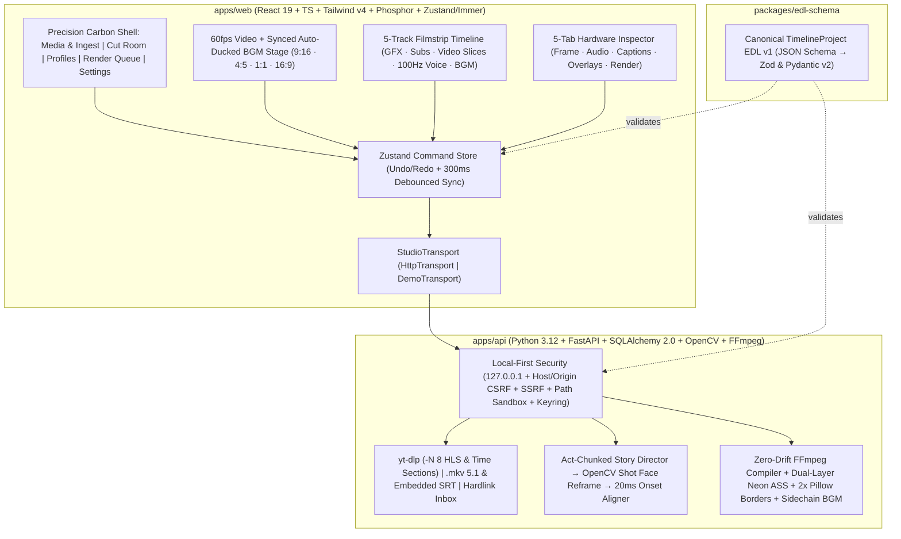

# CutFlow — Local-First Zero-Touch Video Clipping Studio & Precision NLE

**CutFlow** turns long Twitch/YouTube/Kick VODs, `.mkv` movies & series, and gaming recordings into finished viral edits (`9:16`, `4:5`, `1:1`, `16:9`) **with zero manual timeline work** — while keeping every cut, face-tracking keyframe, neon-glow caption, graphic overlay, and auto-ducked BGM stem **100% non-destructive and editable** inside a desktop-grade **Precision Carbon Studio** Non-Linear Editor (NLE).

> **Dual-Mode Architecture:** Run 100% locally with full FFmpeg / OpenCV / Whisper / OS Keyring privacy, **or** deploy the static **$0 Hosted Interactive Demo Mode** (`npm run build:demo`) to Vercel, Cloudflare Pages, or Netlify with zero backend cost.


---

## Supported Sources & Ingest Matrix

| Source Type | Examples | Supported | Pipeline Behavior |
| :--- | :--- | :---: | :--- |
| **Twitch Long VODs & Clips** | `https://www.twitch.tv/videos/...` | **Yes** | Instant VOD Inspector (title, duration, stream chapters) → choose **Full VOD** (`8×` parallel HLS fragments) or **Time Window** (`--download-sections` fast range clip) + optional browser cookies for subscriber VODs. |
| **YouTube, Kick, TikTok, X (~1,800 `yt-dlp` sites)** | `youtube.com/watch?v=...`, `kick.com/...` | **Yes** | SSRF-guarded `yt-dlp` ingest + live SSE `MB/s` telemetry + YouTube Most-Replayed heatmap & chapter fusion. |
| **Local Cinema `.mkv` & Video Files** | `.mkv`, `.mp4`, `.mov`, `.webm`, `.avi` + optional `.srt`/`.ass` | **Yes (Recommended for Movies/TV)** | Zero-copy NTFS hardlink watch folders, `<0.5s` embedded or sidecar subtitle extraction (`$0` ASR cost), 5.1/7.1 Front-Center (`FC`) dialogue isolation, and automatic `cropdetect` letterbox stripping. |
| **DRM / Anti-Bot Streaming Sites** | Netflix, Disney+, obfuscated web players (`kisskh`, etc.) | **No** | CutFlow does not bypass DRM or anti-bot challenges; pasting an unsupported streaming page shows a clear diagnostic prompt to drop a local `.mkv` or `.mp4` file instead. |

---

## Key Capabilities

### 1. Zero-Touch Viral & Cinema Editing Engine
- **Cinema & Prestige TV Mode (`Cinema & TV Edits` Profile):**
  - **Multi-Slice Story Arcs (`18s–180s`):** Full 2-hour movie **Act Chunking** discovers cohesive single-scene or multi-scene dramatic arcs without mid-movie token cutoffs.
  - **Autonomous Per-Shot Face Reframing:** Detects internal camera cuts (`select='gt(scene,0.28)'`) and runs local OpenCV face detection to generate per-shot `panX`, `panY`, and optical `zoom` keyframes locking speakers in `1:1` (`1080×1080`), `4:5` (`1080×1350`), or `9:16` (`1080×1920`).
  - **Signature Cinema Visual Stack:** Flush full-width white **`POV:` Top Header Bar**, 2× supersampled **Inner Rounded Borders** (`thin_rounded` with top accent bar or `double_cinema`), **Crisp HD Grade** (`eq` + `unsharp`), 2D translucent **Watermark**, and **Film Credit** pills.
- **Viral Gaming & Challenge Mode (`Viral Gaming Challenge` Profile):**
  - **Semantic Punch-Word Neon Bloom (`viral_punch_glow`):** Clean uppercase captions where numbers, money, danger/action verbs, and hype words automatically bloom with colored neon halos.
  - **Zero-Drift Cut Transitions + SFX:** Duration-preserving `flash_white` + `whoosh_flash` and `dip_black` + `cinema_hit` transitions that keep word-level subtitle sync exact to the millisecond across 15+ jump cuts.
  - **Multi-Clip Theme Mashup Compiler:** Select any `2–12` generated clips (even across different movies or VODs) in **Media & Ingest** to stitch a unified compilation with transitions, `POV:` hook, and BGM in one click.

### 2. Dual-Layer `libass` Subtitles & Autonomous Studio Audio
- **6 Caption Styles & 3 Reveal Modes:** `cinema_neon_glow` (dual-layer `\blur12` neon outer aura + phrase-rotating color palette + zero black cartoon border), `viral_punch_glow`, `bold_pop`, `karaoke_fill` (true `\kf` sweep), `clean_lower`, and `boxed` across `progressive`, `group`, and `single_word` cadences — snapped to **20ms audio speech onsets**.
- **Built-In BGM Library, Beat-Drop Sync & Sidechain Auto-Ducking:**
  - Synthesizes royalty-free stereo starter beds (`Dark Cinema Synth Pulse`, `Upbeat Challenge Drive`) and transition SFX on first boot, plus 1-click upload for custom `.mp3` / `.wav` / `.m4a` tracks (`~/.cutflow/bgm/`).
  - Automatically scans custom songs (`find_bgm_start_offset_ms`) to skip quiet intros and land on the beat drop.
  - Compiles FFmpeg `sidechaincompress` auto-ducking (`amix=normalize=0`) so music ducks cleanly under dialogue and swells during dramatic pauses, finished with vocal clarity EQ (`dialogueEnhance`) and `-14 LUFS` EBU R128 loudness normalization.

### 3. "Precision Carbon Studio" NLE & Co-Editor
- **Desktop Studio Shell:** Neutral matte carbon surfaces (`#09090B` / `#111114` / `#18181C`), `1px` hairlines, compact `54px` `@phosphor-icons/react` left rail, vector platform/provider marks, and custom `ScrubSlider` / drag-scrubbable `ScrubNumber` controls.
- **60fps Direct-Manipulation Stage:** Previews `9:16`, `4:5`, `1:1`, and `16:9` aspect ratios with live pan-drag reframing, 2D overlay dragging, neon-glow captions, cut flashes, and **synced `<audio>` BGM playback with real-time RMS ducking**.
- **5-Track Filmstrip Timeline & 5-Tab Inspector:** Real video filmstrip thumbnails (`filmstrip.jpg`), clickable cut transition badges (`Flash` / `Dip`), 100 Hz vocal waveform with onset snap, dedicated **A2 · BGM** lane, `Frame | Audio | Captions | Overlays | Render` inspector, and an **Optimistic AI Co-Editor** with 1-click **Revert**.

---

## Starter Profiles & Hands-Free Workflow

CutFlow seeds 4 ready-to-use profiles on startup (each with its own local watch folder under `~/clip-farming/inbox/<profile-id>`):

1. **General Gaming Streamer** — `9:16` auto facecam/gameplay split-screen + white seam headline card + cold-open hook.
2. **Cinema & TV Edits (JJ_EDIT Style)** — `1:1` Cinema Square + auto face reframe + `cinema_neon_glow` + `POV:` bar + `thin_rounded` frame + `crisp_hd` grade + auto-ducked dark synthwave BGM.
3. **Viral Gaming Challenge (MrBeast Style)** — `9:16` + `viral_punch_glow` + `flash_white` + whoosh SFX + automatic dead-air silence tightening + upbeat challenge BGM.
4. **Talking Head / Podcast** — `9:16` speaker-centered reframe + dark hook banner + clean dialogue pacing.

> **Preview First vs. 100% Hands-Free MP4s:** By default, generated clips land in **Cut Room** for instant 60fps review (`auto_export=false`). Flip **Hands-Free MP4 Render on Ingest** on any profile card to render finished MP4 masters straight to `~/.cutflow/exports/` automatically whenever a file is dropped or a VOD finishes downloading.

---

## System Architecture



---

## Quick Start

### Prerequisites
- **Python 3.12** (with [`uv`](https://docs.astral.sh/uv/) recommended)
- **Node.js 22+**
- **FFmpeg + FFprobe** with `libass` enabled (`ffmpeg -version` shows `--enable-libass`)
- Optional: `faster-whisper` (`uv pip install -e ".[ml]"`) for local GPU/CPU Whisper transcription (`yt-dlp` and `opencv-python-headless` install automatically with `apps/api`)

### 1. Install Backend & Frontend

```powershell
# Backend (Python 3.12 + SQLite/Alembic + yt-dlp + OpenCV)
cd apps/api
uv venv --python 3.12
uv pip install -e ".[dev]"
.\.venv\Scripts\cutflow.exe doctor

# Frontend (React 19 + TypeScript + Vite + Tailwind v4)
cd ../web
npm install
npm run build
```

### 2. Run Locally

```powershell
# Option A: Hot-reload development (API :8010 + Vite HMR :5173)
.\scripts\dev.ps1

# Option B: 1-click Windows launcher (serves built UI directly on http://127.0.0.1:8010)
.\scripts\Launch-CutFlow.bat

# Option C: Direct CLI server
cd apps/api
.\.venv\Scripts\cutflow.exe serve --port 8010
```

### 3. Configure AI Provider & Optional Twitch Cookies
Open **Studio Settings** (`Sliders` icon in the left rail):
- Select **Google Gemini**, **Anthropic Claude**, **OpenAI**, **Groq**, or **Local Ollama** (`127.0.0.1:11434`, zero API key required) and save keys directly into your OS Keyring.
- For subscriber-only Twitch VODs, set **Browser Cookies** (`Chrome`, `Edge`, `Firefox`, or `Brave`) and adjust **Concurrent HLS Fragment Workers** (`8×` default).

### 4. Build the $0 Hosted Interactive Demo Mode

```bash
cd apps/web
npm run build:demo
# Deploy apps/web/dist-demo/ to Vercel, Cloudflare Pages, or Netlify ($0 static hosting)
```

---

## Local-First Security Model

See [docs/SECURITY.md](docs/SECURITY.md) for full threat-model details:

| Threat | Mitigation |
| :--- | :--- |
| **DNS Rebinding / Cross-Origin Tab CSRF** | Loopback-only `127.0.0.1` bind + ASGI `Host` / `Origin` / `Referer` validation middleware |
| **API Key Leakage** | Write-only OS Keyring (`keyring`) — keys are never written to SQLite, `config.json`, logs, or API responses |
| **SSRF via URL Ingest** | Scheme (`http`/`https`) + DNS/IP-literal guard blocking loopback, RFC1918, link-local, and cloud metadata IPs |
| **Path Traversal** | Slug sanitization + `safe_resolve()` (`Path.resolve().is_relative_to(allowed_root)`) across media, slices, BGM, peaks, and exports |
| **Command / Filter Injection** | Zero `shell=True`; explicit argv lists with `--` flag terminators; Pillow RGBA PNGs avoid raw user text in FFmpeg `drawtext` |

---

## Testing & Verification

```powershell
# Backend: Ruff lint + 57 unit, security, MKV/5.1/SRT, OpenCV reframe, mashup & FFmpeg BGM render tests
cd apps/api
.\.venv\Scripts\ruff.exe check src tests
.\.venv\Scripts\pytest.exe -q

# Frontend: TypeScript strict check + Vitest EDL/Store/DemoTransport suite + Production & Demo builds
cd ../web
npm run typecheck
npm test
npm run build
npm run build:demo
```

---

## Repository Structure

```text
cutflow/
├── apps/
│   ├── api/                 # Python 3.12 + FastAPI + OpenCV + yt-dlp + FFmpeg/libass/BGM compiler
│   └── web/                 # React 19 + TypeScript + Tailwind v4 + Precision Carbon Studio NLE
├── packages/
│   └── edl-schema/          # Canonical timeline.v1.schema.json + cross-language EDL fixtures
├── docs/                    # Studio preview screenshot & security architecture notes
├── scripts/                 # dev.ps1, Launch-CutFlow.bat, Stop-CutFlow.bat
├── docker-compose.yml       # Optional PostgreSQL & API container setup
└── .github/workflows/ci.yml # Ruff, Pytest, Vitest, Production Build & Demo Build CI
```

## License

MIT License — see [LICENSE](LICENSE).
