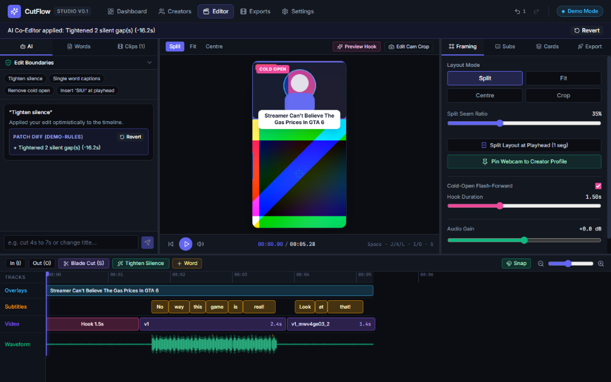
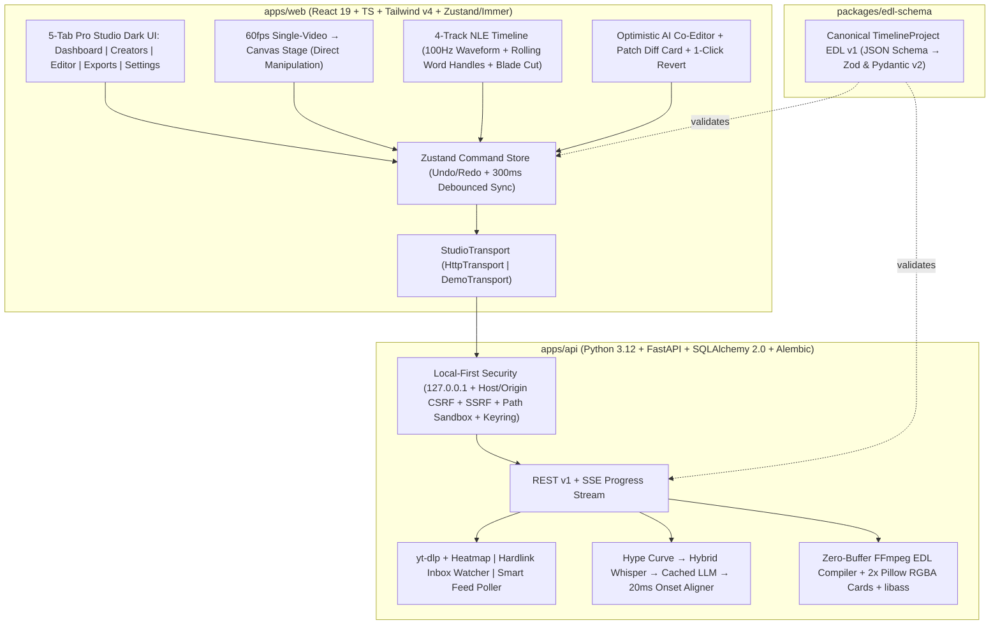

# CutFlow — Local-First AI Video Clipping Studio & Non-Linear Timeline Editor

**CutFlow** turns long gaming VODs, IRL livestreams, and YouTube/Kick/Twitch links into ready-to-post vertical shorts — paired with a **Pro Studio Dark** CapCut/Premiere-style Non-Linear Timeline Editor (NLE), a **20ms audio-onset subtitle aligner**, a **zero-buffer FFmpeg EDL compiler**, and an **Optimistic AI Co-Editor** with 1-click Revert.

> **Dual-Mode Architecture:** Run 100% locally with full FFmpeg / Whisper / OS Keyring privacy, **or** deploy the static **$0 Hosted Interactive Demo Mode** (`npm run build:demo`) to Vercel / Cloudflare Pages with zero cloud backend cost.



---

## Key Capabilities

- **Drop Video or Paste URL → Automatic Editable Clips:** Drag-and-drop uploads, zero-copy NTFS hardlink `inbox/<creator>/` folder watching, SSRF-hardened `yt-dlp` ingest (YouTube, Kick, Twitch, TikTok, X), and a zero-download **Smart Feed ("Check & Notify")** channel poller.
- **Multi-Signal Hype Curve & Hot-Window Scoped Long-VOD ASR:** Fuses YouTube `heatmap` replay spikes with 2-second WAV RMS energy bursts to transcribe *only* top non-overlapping hot windows on multi-hour VODs (`> 25 min`) — keeping 4 GB VRAM & cloud 24 MB Whisper uploads fast — plus `sha256`-keyed LLM response caching so retries cost zero API quota.
- **Unified `TimelineProject` EDL v1 Contract:** Single versioned JSON Schema (`packages/edl-schema/timeline.v1.schema.json`) validated identically in **Pydantic v2** (Python) and **Zod** (TypeScript) across Preview, Undo/Redo, AI Co-Editor, and FFmpeg Export.
- **60fps Single-`<video>` → `<canvas>` Direct-Manipulation Stage & Multi-Segment Framing Keyframes:** Decodes one 0.2s lossless stream-copied clip slice (`-c copy`) once and composites split-screen facecam + gameplay at 60fps — drag the **split seam**, **facecam crop box** (with **1-click Pin Webcam to Profile**), **White Rounded Seam Title Card**, and **live captions** right on the stage, or **Split Layout at Playhead** to switch dynamically between `Split`, `Fit`, and `Centre` mid-clip.
- **Premiere-Style Multi-Track Timeline & 1-Click "Tighten Silence":** High-DPI 100 Hz `<canvas>` audio waveform, magnetic **Snap to Waveform**, rolling-edit Word Time-Stop handles, double-click inline word rename, **1-click Tighten Silence** (auto jump-cuts dead-air pauses `>= 1.1s` right-to-left with natural breath padding), In/Out (`I`/`O`) & Blade-Cut (`S`), smooth playhead auto-scroll, and full NLE hotkeys (`Space`, `J`/`K`/`L`, `←`/`→` frame-step, `Ctrl+Z` / `Ctrl+Shift+Z`).
- **3 Subtitle Reveal Modes, True `\kf` Karaoke Sweep & 20ms Audio-Onset Sync:** Supports **`progressive`** (word-by-word build preventing early pop-in), **`group`**, and **`single_word`** ASS caption reveal modes plus smooth libass `\kf` **Karaoke Fill** sweeps, anchored to real 20ms speech onsets.
- **2× Supersampled Pillow RGBA Seam Title Cards & Zero-Buffer FFmpeg Compiler:** Renders silky anti-aliased rounded overlays via Pillow RGBA PNGs (zero FFmpeg `drawtext` injection), compiles arbitrary mid-clip blade cuts + Cold-Open flash-forwards via per-slice seeked inputs, normalizes audio to `-14 LUFS`, and supports **1-click Raw VOD Archiving** (delete multi-GB raw VODs while keeping ~15 MB lossless slices 100% playable & re-exportable!).
- **Optimistic AI Co-Editor & Social Delivery:** Natural-language timeline editing obeying persistent **Edit Boundaries**, compact **Patch Diff Cards** with 1-click **Revert**, Clip Approval workflow (`Draft → Approved → Exported → Posted`), and 1-click **Viral Post Copy** generation.

---

## System Architecture



---

## Real Hardware Benchmarks (`cutflow benchmark`)

Measured directly via `cutflow benchmark --duration 12` on a consumer **Windows 11 · 16 GB RAM · NVIDIA GTX 1050 Ti (4 GB VRAM)** workstation running FFmpeg `9.1` (CPU `libx264` bounded-lookahead fallback automatically selected by `cutflow doctor` when driver NVENC API `13.0 < 13.1`):

| Pipeline Stage | Measured Time | Notes |
| :--- | ---: | :--- |
| FFprobe Metadata | 112 ms | 1920×1080 @ 30fps |
| 16 kHz Mono WAV Extract | 138 ms | PCM s16le |
| 100 Hz Waveform Peaks | 27 ms | 12.9 KB JSON |
| 20ms RMS Onset Alignment | 1 ms | Snapped 0ms → 1480ms |
| Zero-Copy Lossless Slice (`-c copy`) | 176 ms | 22.71 MB stream copy |
| Render 720p Draft (9:16 Split + Card + ASS) | 2.56 s | `libx264`, 1.89 MB |
| Render 1080p Final (9:16 Split + Card + ASS) | 5.45 s | `libx264`, 7.98 MB |

Run it on your own machine anytime:

```bash
cutflow doctor
cutflow benchmark --duration 12
```

---

## Local-First Security Model

CutFlow is built for safe daily operation on developer & creator workstations (see [docs/SECURITY.md](docs/SECURITY.md) for details):

| Threat | Mitigation |
| :--- | :--- |
| **DNS Rebinding / Cross-Origin Tab CSRF** | Loopback-only `127.0.0.1:8010` bind + ASGI `Host` / `Origin` / `Referer` middleware |
| **API Key Leakage** | Write-only OS Keyring (`keyring`) — keys never touch SQLite, `config.json`, logs, or API responses |
| **SSRF via URL Ingest** | Scheme (`http`/`https`) + pre-flight DNS & IP-literal guard blocking loopback, RFC1918, link-local, and cloud metadata IPs |
| **Path Traversal** | Slug sanitization + `Path.resolve().is_relative_to(allowed_root)` enforcement on every upload, slice, peak, and export |
| **Command / Filter Injection** | Zero `shell=True`; explicit argv lists with `--` flag terminators; Pillow RGBA PNGs eliminate raw user text in FFmpeg `drawtext` |

---

## Quick Start

### Prerequisites
- **Python 3.12** (with [`uv`](https://docs.astral.sh/uv/) recommended)
- **Node.js 22+**
- **FFmpeg + FFprobe** with `libass` enabled (`ffmpeg -version` shows `--enable-libass`)
- Optional: `yt-dlp` on `PATH` for YouTube/Kick/Twitch URL & Smart Feed ingestion; `faster-whisper` (`uv pip install -e ".[ml]"`) for local GPU/CPU ASR

### 1. Install Backend & Frontend

```powershell
# Backend (Python 3.12 + Alembic migrations)
cd apps/api
uv venv --python 3.12
uv pip install -e ".[dev]"
.\.venv\Scripts\cutflow.exe doctor

# Frontend (React 19 + TypeScript + Vite + Tailwind v4)
cd ../web
npm install
npm run build
```

### 2. Run Locally

```powershell
# Hot-reload development (API :8010 + Vite HMR :5173)
.\scripts\dev.ps1

# Or 1-click Windows launcher (serves built UI directly on http://127.0.0.1:8010)
.\scripts\Launch-CutFlow.bat
```

### 3. Build the $0 Hosted Interactive Demo Mode

```bash
cd apps/web
npm run build:demo
# Deploy apps/web/dist-demo/ to Vercel, Cloudflare Pages, or Netlify ($0 static hosting!)
```

Append `?demo=1` in local development to preview `DemoTransport` with the bundled copyright-safe clip (`apps/web/public/demo/sample_clip.mp4`), live 60fps canvas stage, 100 Hz waveform, and client-side AI Co-Editor.

---

## Testing & Verification

```bash
# Backend: Lint + Unit, Security, Real FFmpeg Pipeline, Render & Co-Editor tests
cd apps/api
uv run ruff check src tests
uv run pytest -v

# Frontend: Zod EDL, Undo/Redo, Waveform Onset Snap, DemoTransport + Production & Demo builds
cd apps/web
npm run test
npm run build
npm run build:demo
```

---

## Repository Structure

```text
cutflow/
├── apps/
│   ├── api/                 # Python 3.12 + FastAPI + SQLAlchemy 2.0 + Alembic + FFmpeg compiler
│   └── web/                 # React 19 + TypeScript + Vite + Tailwind v4 + Zustand/Immer NLE
├── packages/
│   └── edl-schema/          # Canonical timeline.v1.schema.json + cross-language test fixtures
├── docs/                    # Security architecture notes
├── scripts/                 # dev.ps1, Launch-CutFlow.bat, Stop-CutFlow.bat
├── docker-compose.yml       # Optional PostgreSQL & API container setup
└── .github/workflows/ci.yml # Ruff, Pytest, Vitest, Production Build & Demo Build CI
```

## License

MIT License — see [LICENSE](LICENSE).
